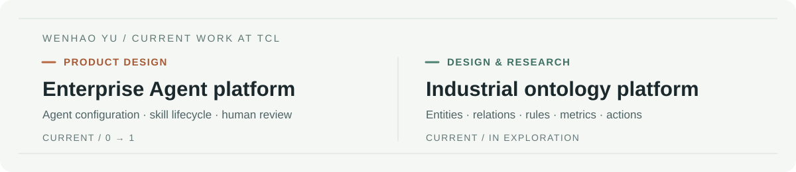

  <picture>
    <source media="(prefers-color-scheme: dark)" srcset="./assets/profile-banner-dark.svg" />
    <source media="(prefers-color-scheme: light)" srcset="./assets/profile-banner-light.svg" />
    
  </picture>
  <h1>Wenhao Yu · Bryan</h1>
  

    <a href="https://wenhaoyu-bryan.github.io/">Portfolio</a> ·
    <a href="https://www.linkedin.com/in/wenhaoyu-bryan/">LinkedIn</a> ·
    <a href="https://wenhaoyu-bryan.github.io/zh/about/">中文介绍</a>
  

At TCL, I lead product design for an enterprise Agent platform and contribute to the design and research of an industrial ontology platform. My independent projects, Prompt-to-Ontology and Agent Anatomy, are smaller public experiments in graph modeling, review, and understanding how agents behave.

## Selected projects

**[Prompt-to-Ontology](https://github.com/wenhaoyu-bryan/Prompt-to-Ontology)** — A runnable Pet Food reference that turns structured data into typed graph objects, evaluates rules with explicit evidence, and routes agent suggestions through human review. [Read the project walkthrough →](https://wenhaoyu-bryan.github.io/projects/prompt-to-ontology/)

**[Agent Anatomy](https://github.com/wenhaoyu-bryan/agent-anatomy)** — Five interactive visual essays that replay an agent's loop, failure modes, web retrieval, memory, and teamwork using one open trace format. [Explore the interactive site →](https://wenhaoyu-bryan.github.io/agent-anatomy/)

[Current work](https://wenhaoyu-bryan.github.io/work/) · [Writing](https://wenhaoyu-bryan.github.io/posts/) · [Email me](mailto:wenhaoyu.bryan@gmail.com)
